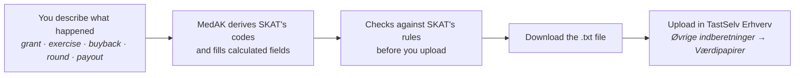

<div align="center">

# MedAK

**Report employee shares to SKAT without wrestling a 62-column spreadsheet.**

A free, open-source alternative to Skattestyrelsen's AKSA 2278 Excel template.
Describe what happened (a grant, a buyback, an investment, a payout); MedAK writes the file.

[](https://github.com/JJGeHa/MedAK/actions/workflows/ci.yml)


[Why](#why) · [How it works](#how-it-works) · [Report types](#report-types) · [Status](#status) · [Development](#development) · [Docs](#documentation) · [På dansk](#på-dansk)

</div>

---

## Why

Danish companies that give employees shares, options or warrants must report each
acquisition to Skattestyrelsen (SKAT) every year. The same applies when a company buys back
its own shares, receives capital that qualifies for investorfradrag, or pays out liquidation
proceeds. SKAT accepts this as a fixed-width text file (*dataindivid 2278*), and offers an
Excel template with macros to produce it.

That template makes you think like the file format:

| In SKAT's Excel template | In MedAK |
|---|---|
| 62 columns per person, mostly codes | A few plain-language questions per event, then 3–4 values per person |
| Share name, date, price and scheme retyped on every row | Entered once per event |
| `KOEBSALGKOD = H`, `PAPIRTYPEKOD = 1` | "Shares granted under the new § 7 P scheme" |
| 15 shares typed as `15000000`, 18.862,50 kr. as `1886250` | Type `15` and `18.862,50` |
| The same amount entered in five fields | Calculated |
| Errors appear at "Dan fil", or later as "Fejl 207" from SKAT | Explained as you type, in Danish or English |
| Too-long values silently cut off | Never truncated; you're told what to fix |
| Corrections: re-file the old line with minus, then the new one | One "correct this" action |
| Windows + Excel + macros | Any modern browser |

## How it works



**Saved, shared and protected.** Cases are saved to your account, so there are no files to keep
track of, and next year starts from last year's company, shares and people. Colleagues and advisors
can work in the same workspace. CPR numbers are encrypted before they reach the database, every
account uses two-factor sign-in, and access rules are enforced by the database itself. See
[security](docs/security.md).

**Built around events, not rows.** A grant to 40 employees is one event (date, scheme,
share, price) plus 40 short entries (who, how many shares, what they paid, what was taxed
through payroll). People are kept in a register, so returning employees are entered once.

**Danish and English throughout.** The app, its help texts and its checks speak both
languages, with SKAT's Danish terms shown alongside so you can match them to SKAT's guidance.
MedAK is built for Danish start-ups and for Danish subsidiaries of international groups
(RSUs from a foreign parent, foreign currencies and exchange rates) alike.

## Report types

All four report types below use the same file format, so MedAK supports them with one engine.

| | Report | Legal basis | Status |
|---|---|---|---|
| **B** | Employee shares, options, warrants, RSUs, matching shares | SIL § 8; LL §§ 7 P, 16, 28 | First guided flow, in design |
| **A** | Company buying back its own shares | SIL § 28 | Engine ready |
| **C** | Capital contributions giving investorfradrag | SIL §§ 29 a, 29 b | Engine ready |
| **D** | Liquidation proceeds | SIL § 28 a | Engine ready. See note below |

> **Liquidation proceeds:** for most liquidations, SKAT's own single-entry form
> (*Enkeltindberetning* in TastSelv Erhverv) is the simplest route, and MedAK will point you
> there. A file is needed only when the shares are listed, or when someone other than the
> liquidated company paid out the proceeds.

## Status

MedAK is in early development.

- [x] Reverse-engineered SKAT's templates and guidance ([format spec](docs/2278-format.md))
- [x] Engine: read, write and validate 2278 files for all four report types
- [x] Validation mapped to SKAT's error codes, with Danish and English messages
- [x] Event model: describe what happened and get the rows, codes and calculated amounts; import existing files losslessly
- [x] CI, a weekly watch for new SKAT templates, and golden-file tests against SKAT's template ([testing](docs/testing.md))
- [ ] Expected files produced with SKAT's Excel template (needs Windows + Excel; [how](docs/testing.md#producing-the-expected-files))
- [x] Web app with accounts, teams, saved cases and the guided employee-share flow (B), in Danish and English
- [x] People import from spreadsheets, corrections of accepted reports, printable review, file history and SKAT error matching
- [ ] Security review and legal groundwork before real data ([checklist](docs/security.md#before-real-data-can-be-entered))
- [ ] Guided flows for A, C and D
- [ ] Sending directly to SKAT over FTPs Gateway (needs access from eKapital)
- [ ] Confirm encoding and file details with SKAT (eKapital), and test against real uploads

## Development

Requires Node.js 22.12 or later.

To run the app locally you need Docker, which runs a local Supabase with fictional data only:

```bash
npm install
npm run db:start       # local database, sign-in and a test mailbox at http://127.0.0.1:54324
cp apps/web/.env.example apps/web/.env.local   # then fill it in, as described in the file
npm run dev            # http://localhost:3100
```

```bash
npm test               # Vitest, including golden files and database access rules
npm run typecheck      # TypeScript
npm run skat:check     # has SKAT published a new template or guidance?
npm run golden:harness # regenerate the Excel harness after editing golden cases (Node 22.18+)
```

```
apps/
  web/              The web app (Next.js)
packages/
  engine/           Reads, writes and validates 2278 files. No runtime dependencies.
supabase/           Database schema and access rules
docs/               Format spec, validation rules, data model, decisions, security, testing
scripts/            Template watch and golden-file harness generator
.github/workflows/  CI and the weekly SKAT template watch
```

Using the engine directly:

```ts
import { checkReport, buildReportBytes, formatIssue } from "@medak/engine";

const issues = checkReport(project, report);   // tied to the event and person
issues.forEach((issue) => console.log(formatIssue(issue, "en")));

const bytes = buildReportBytes(project, report); // the file to upload
```

See [packages/engine](packages/engine) for a full example.

## Documentation

| Document | What's in it |
|---|---|
| [2278-format.md](docs/2278-format.md) | The file format, field by field, and how SKAT's template formats values |
| [validation-rules.md](docs/validation-rules.md) | Every check, its severity, and the SKAT error code it anticipates |
| [data-model.md](docs/data-model.md) | Which values are entered once per report, event or person |
| [decisions.md](docs/decisions.md) | Scope, principles, stack and UX decisions |
| [testing.md](docs/testing.md) | Unit tests, golden files from SKAT's template, and the template watch |
| [security.md](docs/security.md) | How data is protected, what isn't covered, and what must happen before real data |

Sources: SKAT's guidance for
[medarbejderaktier and egne aktier](https://info.skat.dk/data.aspx?oid=2289412),
[investorfradrag](https://info.skat.dk/data.aspx?oid=16096) and
[likvidationsprovenu](https://info.skat.dk/data.aspx?oid=1918), and the templates on
[skat.dk](https://skat.dk/erhverv/ekapital/vaerdipapirer/selskabers-indberetning-af-medarbejderaktier-og-koeb-af-egne-aktier).

## Important

- **Not tax advice.** MedAK helps you produce a correctly formatted report. Its explanations
  of whether and what to report are general information only. If you are in any doubt about
  your situation, seek professional advice.
- **You remain responsible.** The reporting company is responsible for the correctness and
  timeliness of its report, whichever tool is used to produce it.
- **Not affiliated with Skattestyrelsen.** MedAK is an independent project.
- **In development.** Don't enter real CPR numbers yet; see the [checklist](docs/security.md#before-real-data-can-be-entered).

## Contributing

Issues and pull requests are welcome. Especially valuable: running the golden-file harness in
SKAT's Excel template on Windows ([how](docs/testing.md#producing-the-expected-files)), and
experience from real uploads.

## Licence

[Apache-2.0](LICENSE).

## På dansk

MedAK er et gratis alternativ til Skattestyrelsens Excel-skabelon AKSA 2278 til indberetning
af medarbejderaktier, selskabers køb af egne aktier, investorfradrag og likvidationsprovenu.
I stedet for 62 kolonner pr. person beskriver du, hvad der er sket, f.eks. en tildeling af
aktier, og MedAK danner filen, som du uploader i TastSelv Erhverv. Sagerne gemmes på din konto,
så du og dine kolleger kan arbejde videre næste år, og cpr-numre er krypterede. Appen er på dansk
og engelsk. MedAK er under udvikling og må endnu ikke bruges med rigtige data.

MedAK yder ikke skatterådgivning. Er du i tvivl om din situation, så søg professionel rådgivning.
